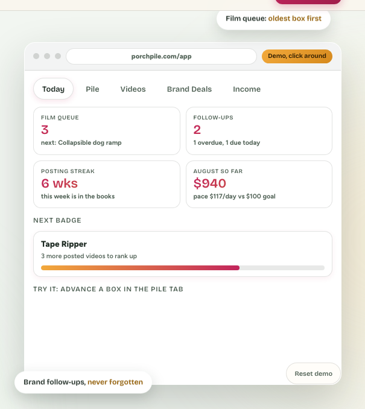
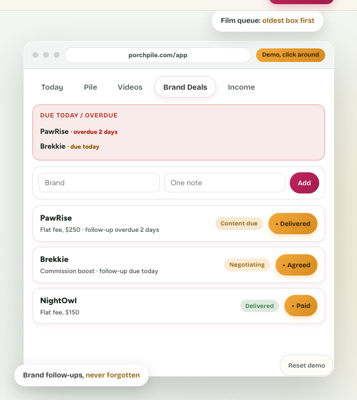
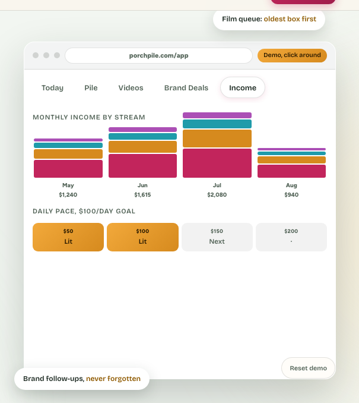

# Porch Pile 🦝

**The tracker for Amazon Influencer creators.** Every product on your porch, every video, every brand deal and every dollar, in one place. A raccoon cheers you on when you post and side-eyes you when a box sits too long.

**[Start with a free plan at porchpile.com](https://porchpile.com)**. No setup, no card. Or run your own copy with the code in this repo.



---

## What it does

| Tab | What you get |
|---|---|
| **The Pile** | Log each product with its brand, where it came from and what it's worth. Boxes that have waited too long get flagged, and a film-next queue picks your next video. |
| **Videos** | A simple pipeline: to film, in review, posted. Link one video to several products, mark where it's posted, and keep a weekly posting streak going. |
| **Brand deals** | A CRM sized for DMs. Save an inquiry in three fields and set a follow-up date. Anything overdue sits in a red strip at the top until you deal with it. |
| **Income** | Enter your monthly totals for commissions, Creator Connections, bounties and brand fees. You get charts, a daily pace goal and your best month. |
| **Coupons** | Every code you've been given, with expiry dates. The ones about to expire float to the top. |
| **Ranks and badges** | Nine ranks from Porch Peeker to Trash Panda Tycoon, plus 22 badges to earn. |

Pro also imports your existing spreadsheet. Every plan works on your phone and has a full how-to guide built in.

<p>


</p>

---

## Two ways to use it

### 1. Use the hosted version (easiest)

Go to **[porchpile.com](https://porchpile.com)** and sign up. The free plan holds 30 products, 15 videos, 3 active brand deals and income for the current and previous month. Pro is $12 a month or $120 a year. It removes the limits and adds spreadsheet import. Paying for Pro is also how you support the project.

### 2. Run your own copy

Porch Pile runs on Cloudflare Workers with a D1 database. You can try it on your own machine with no Cloudflare account. Putting it online needs a free one.

You'll need [Node.js](https://nodejs.org) 22 or newer.

```bash
git clone https://github.com/jensoltys/porchpile.git
cd porchpile
npm ci

# Local settings. Open .dev.vars and replace CHANGE_ME with 32 or more random
# characters (openssl rand -hex 32 makes one). Signup and login refuse to work
# until you do. Leave APP_URL=http://localhost:8787 in there: the app only accepts
# form posts from APP_URL, and this points it at your machine.
cp .dev.vars.example .dev.vars

npm run migrate:local
npm run dev
```

Open `http://localhost:8787`. With `DEV_LOG_CODES=true` in `.dev.vars`, the 6-digit signup code and any password reset link print in your terminal, so you can test without setting up email.

**To put it online** you'll need a [Cloudflare account](https://dash.cloudflare.com/sign-up):

```bash
npx wrangler login
# Create your database, then paste the database_id it prints into wrangler.toml
npx wrangler d1 create porch-pile
npm run migrate:remote
npx wrangler secret put PP_SESSION_SECRET
npx wrangler secret put RESEND_API_KEY      # for signup and password reset emails
npm run deploy                              # runs the security, webhook and login tests, then deploys
```

Then set `APP_URL` in `wrangler.toml` to your live address and run `npm run deploy` again. `.dev.vars` is only read by `npm run dev`, so the localhost address never goes live.

### Settings

| Setting | Needed? | What it's for |
|---|---|---|
| `PP_SESSION_SECRET` | **Yes** | Signs logins. The app refuses to start a session without a 32+ character secret. |
| `APP_URL` | **Yes** | Your site's full address, like `https://porch-pile.you.workers.dev`. The app only accepts form posts from it, and it's put in front of the share-preview image and page links so link previews work. |
| `APP_NAME` | Optional | The name sent with server error alerts (see `ALERT_WEBHOOK_URL`). It's `Porch Pile` in `wrangler.toml`. |
| `EXTRA_ORIGINS` | Optional | More addresses allowed to post forms, comma separated. Use it when the same copy answers on a second address, like a `www.` version of your domain. |
| `RESEND_API_KEY` + `EMAIL_FROM` | For a live site | Sends signup codes and password resets through [Resend](https://resend.com). |
| `TURNSTILE_SECRET` | Recommended | Bot check on signup. Also put your site key in `TURNSTILE_SITEKEY` in `public/app.html`. |
| `STRIPE_SECRET_KEY`, `STRIPE_WEBHOOK_SECRET`, `STRIPE_PRICE_*` | Optional | Only if you want to charge for Pro on your copy. Payments go to your Stripe account. Without a key and a monthly price, the pages hide prices and Go Pro, and checkout says paid plans aren't set up on this copy. See **Charging for Pro** below. |
| `STRIPE_AUTOMATIC_TAX` | Optional | `"true"` turns on Stripe Tax at checkout. It's `"false"` to start, because it only works once you've set up Stripe Tax in your Stripe account. |
| `COMP_SECRET` | Optional | Lets a tool you trust give someone Pro with `POST /api/internal/comp-access` (header `X-Internal-Secret`, body `{"email": "...", "months": 6}`), and take it back with `POST /api/internal/revoke-access` (same header, body `{"email": "..."}`). Neither one touches a paying subscriber. Leave blank and both endpoints refuse every call. |
| `FEEDBACK_WEBHOOK` | Optional | Any URL that takes a JSON POST. Feedback from the in-app button goes there. Leave it blank and the Feedback button doesn't show. |
| `SIGNUP_WEBHOOK_URL` + `SIGNUP_WEBHOOK_SECRET` | Optional, set both | Pings your URL with the email of each new signup. The secret is sent in an `X-Signup-Secret` header so your tool can check it. With either one blank, nothing is sent. |
| `ALERT_WEBHOOK_URL` + `ALERT_TOKEN` | Optional, set both | Tells your URL about server errors (up to 3 a minute). The token is sent in an `X-Alert-Token` header. With either one blank, nothing is sent. |
| `AFFILIATE_API_URL` + `CONVERSION_WEBHOOK_SECRET` | Optional, set both | Only with billing on. Reports paid and refunded Pro sales from referral links to your own affiliate platform, at `AFFILIATE_API_URL/record-conversion` and `/reverse-conversion`. The secret is sent in an `X-Webhook-Secret` header. With the URL blank, nothing is sent. |

**Free plan limits.** These only apply when billing is set up. Without Stripe, nobody can buy Pro on your copy, so every account gets everything: no caps, the full income history and spreadsheet import, with no Pro labels or upgrade prompts. Once billing is on, the item, video and deal caps live in `FREE_CAPS` in `src/worker.js`. Two more limits don't: free accounts see income for the current and previous month only (`freeIncomeMonths` in `src/worker.js`), and spreadsheet import is Pro only (`src/lib/import.js`). Changing `FREE_CAPS` doesn't touch those two.

**Giving someone Pro on your copy** (yourself included). This only matters once billing is on, since a copy without billing has no limits. Run this once with their email:

```bash
npx wrangler d1 execute porch-pile --remote --command "UPDATE users SET pro_until = '2126-01-01T00:00:00.000Z' WHERE email = 'you@example.com'"
```

Use `--local` instead of `--remote` for your test copy. Set `pro_until` to `NULL` to take Pro away again.

### Charging for Pro

1. In Stripe, make a product with a monthly and an annual price. Put the price IDs in `STRIPE_PRICE_MONTHLY` and `STRIPE_PRICE_ANNUAL`, and set `STRIPE_SECRET_KEY` with `npx wrangler secret put`.
2. Add a webhook endpoint at `https://YOUR-ADDRESS/api/stripe/webhook` for these events: `checkout.session.completed`, `customer.subscription.created`, `customer.subscription.updated`, `customer.subscription.deleted`, `invoice.paid`, `invoice.payment_failed` and `charge.refunded`. Put its signing secret in `STRIPE_WEBHOOK_SECRET`.
3. Optional: a customer portal configuration ID in `STRIPE_PORTAL_CONFIG`, and `STRIPE_AUTOMATIC_TAX = "true"` once Stripe Tax is set up.
4. Change the prices people see to match yours. They're typed into these spots:
   - `public/app.html`: `PRICE` (the Go Pro buttons and the renewal line next to them), plus the "(2 months free)" label beside it.
   - `public/index.html`: the Pro card (`$12/month`, `$120/year, 2 months free`, and the renewal line under Go Pro) and the "How much does Pro cost?" answer.
   - If you want search engines to see your prices, add `Offer` entries back to the `SoftwareApplication` data near the top of `public/index.html`.

### Before you run it publicly

- The pages in `public/legal/` are templates. Put in your own company name, `YOUR BUSINESS ADDRESS` and contact emails, there and in the page footers.
- Read through `public/index.html`, your homepage. Its wording, FAQ and the "Who made it" credit are yours to change.
- The app shows a few tips that link to my other tools, plus affiliate links to OINK, Levanta and Logie. Commissions from those links go to me, and their labels say so. They're in the `NUDGES` list in `public/app.html` if you want to change or remove them.
- If you change the code, point the **Open source** link in the page footers at your own copy of the source. The AGPL asks you to offer your changed code to the people who use your site.
- Charging for Pro? Check every price spot listed under **Charging for Pro**.

### Keep your copy as safe as porchpile.com

Your copy runs the same code as porchpile.com, so it gets the same protection: hashed passwords, a lockout after 5 wrong passwords from one network (someone else's wrong guesses never lock the real owner out), limits on signup-code guesses (8 a minute, 20 a day), every session signed out when a password is reset, and checks that block requests from other websites. Logging out clears the session on that device, and changing the password signs out every device. A few of those depend on your setup:

- [ ] **Use a long random `PP_SESSION_SECRET`.** Signup and login answer "Server isn't set up" until it has 32+ characters. `openssl rand -hex 32` makes a good one.
- [ ] **Turn on Turnstile** (`TURNSTILE_SECRET` plus the site key in `public/app.html`). Without it, signup has no bot check.
- [ ] **Set up email before going live** (`RESEND_API_KEY` and `EMAIL_FROM`). Never set `DEV_LOG_CODES` on a live site.
- [ ] **Keep secrets out of git.** Store them with `npx wrangler secret put`, never in `wrangler.toml`. `.dev.vars` is already ignored.
- [ ] **Charging for Pro?** Set `STRIPE_WEBHOOK_SECRET` and add the webhook in Stripe. Without the secret, every payment message is turned away. New subscribers still get Pro when they come back from checkout, but renewals and cancellations never reach your copy.
- [ ] **Stay updated.** Security fixes made on porchpile.com get copied here. Click **Watch** at the top of this page to hear about them, then pull and redeploy.

Found a security problem? See [SECURITY.md](SECURITY.md).

---

## Tests

```bash
npm run test:security   # scans for common security mistakes
npm run test:import     # spreadsheet import
npm run test:nudges     # reminder logic
npm run test:ratelimit
npm run test:webhook
npm run test:flags      # what the pages hide when billing or feedback is off
npm run test:auth       # login lockout, free plan limits, feedback limits
```

## Made by

**Jen Soltys**, an Amazon Influencer creator. I build small apps that fix everyday annoyances at **[Jen Built It](https://jenbuiltit.com)** and write about building with AI at **[jen8n.com](https://jen8n.com)**.

If Porch Pile helps you, the best support is a **[Pro plan on porchpile.com](https://porchpile.com)** or a ⭐ on this repo.

## Contributing

Bug reports and ideas are welcome in [Issues](../../issues). I'm not taking pull requests right now, which keeps the commercial license option possible. You're free to fork it and make it yours under the license below. See [CONTRIBUTING.md](CONTRIBUTING.md) and the [code of conduct](CODE_OF_CONDUCT.md).

**Getting help:** self-hosted copies are community-supported. You run your copy, so you handle its setup, updates, backups and security. [SUPPORT.md](SUPPORT.md) says where to ask.

## License

[AGPL-3.0](LICENSE). You can use, change and share Porch Pile. If you run a changed version as a website for other people, you have to share your changed code under the same license.

### Commercial license

Want to build Porch Pile into a product without sharing your code, or run a changed version for customers without publishing your changes? You can buy a commercial license that replaces the AGPL terms for your business. Email **hello@jenbuiltit.com** with what you're building.

Porch Pile isn't affiliated with or endorsed by Amazon. Amazon and the Amazon logo are trademarks of Amazon.com, Inc. or its affiliates. Other product names are trademarks of their owners, and Porch Pile isn't affiliated with them.

## Trademarks

The license covers the code, not the name. "Porch Pile", its logo and its look aren't licensed for your own product. If you run a changed copy for other people, give it your own name and branding. Saying it's "powered by Porch Pile" is fine. Don't present your copy as the original or as run or endorsed by Jen Built It.
